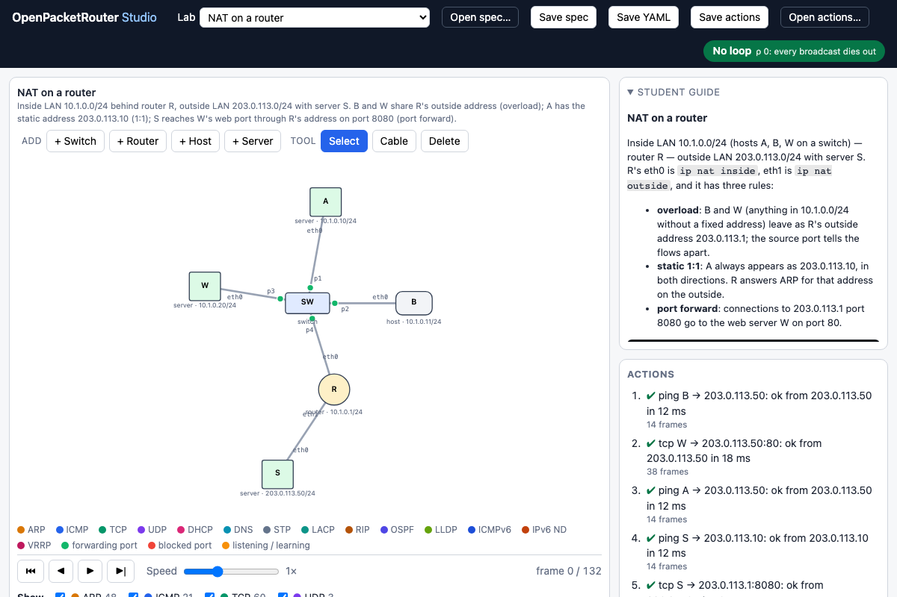
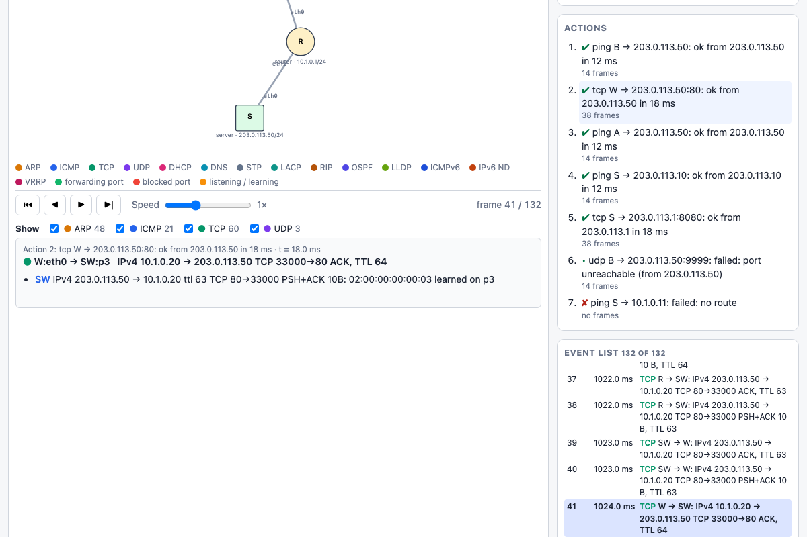
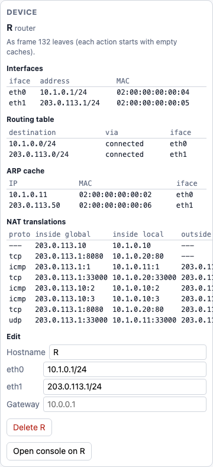
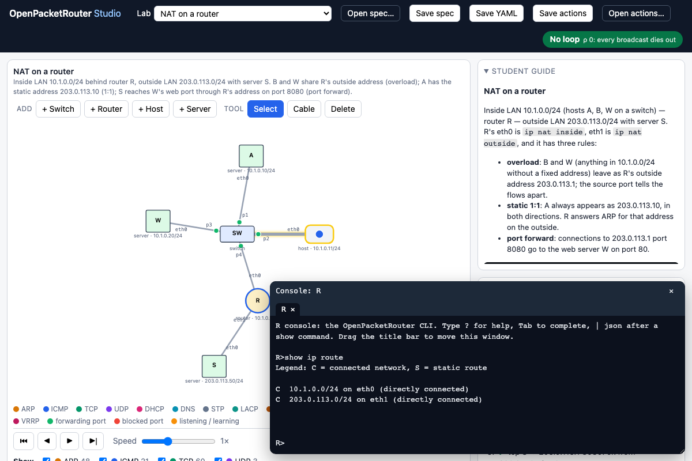
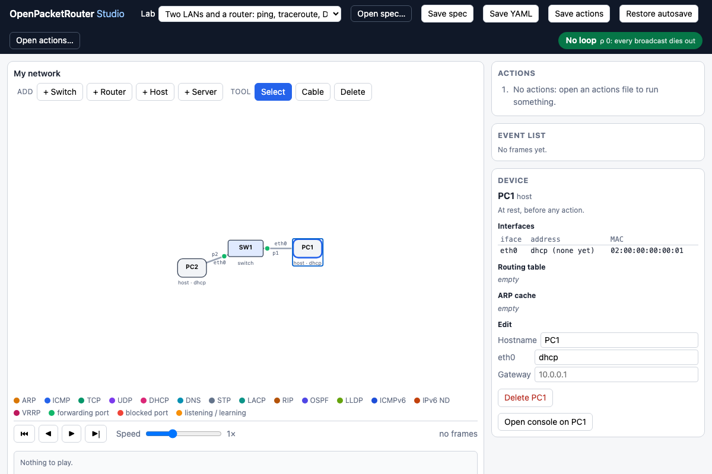
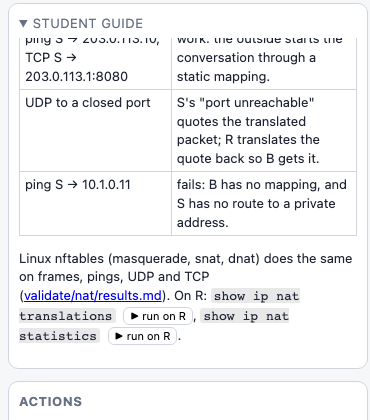

# Studio user guide

Studio is the browser workspace for OpenPacketRouter: you build or open a network, run actions on it, and watch every frame travel
across the cables. It runs the same engine as the command line, so what you see is what `openpacketrouter run` would print.

Start it from the repository root with any static file server, for example `python3 -m http.server 8000`, then open
`http://localhost:8000/studio/`. Nothing is installed and nothing leaves your computer.

## 1. Open a lab

Pick one from the **Lab** list at the top. The map shows the devices and cables, the **Actions** list on the right shows what the
lab does (pings, TCP connections, DNS lookups and so on), and the **Student guide** box explains what to look for.

A green mark beside an action means it worked, a red cross means it failed (a failure can be the point of the lab), and a small dot
means a step that only waits or changes a cable.

## 2. Play and step through the frames

Use the buttons under the map: ⏮ back to the start, ◀ one frame back, ▶ play or pause, ▶| one frame forward. The slider changes the
speed. The keyboard works too: Space plays or pauses, the arrow keys step, Home goes to the start.

Each frame is a coloured dot travelling along a cable, and a sentence under the controls says what it is ("ARP: who has 10.1.0.11?").
Click an action to jump to its first frame.

- **Show** (under the controls): untick a protocol to hide its frames, for example everything except ICMP.
- **Event list**: every frame in order with its time. Click one to jump there.
- **Cables**: click a cable to unplug it, click again to plug it back in; the network re-runs and you see what breaks.

## 3. Look inside a device

Click a device on the map. The **Device** box shows its interfaces and MAC addresses, routing table, ARP cache and, depending on
what it runs, a MAC table, spanning tree ports, DHCP leases, RIP/RIPng/OSPF/BGP neighbors and routes, NAT translations, ACL hit
counts, LACP bundles, LLDP neighbors, VRRP groups and service logs. The tables are those at the frame you are looking at, so step
forward and watch them change.

## 4. Use the console

Double-click a device, or press **C** on a focused one, or use "Open console" in its box. The console is the real OpenPacketRouter CLI:
`?` lists commands, Tab completes, `| json` after a `show` command prints JSON. Several consoles can be open as tabs.

Configuration typed in a console changes the network on the map straight away, and `ping` and `traceroute` add their frames to the
playback.

## 5. Build your own network

The row above the map is the editor.

1. **+ Switch, + Router, + Host, + Server** add a device.
2. **Cable**: click two devices to connect them. **Delete**: click a cable or a device to remove it.
3. **Select**: click a device and edit its hostname, addresses and gateway in the form in the Device box. Studio checks every change
   with the same validator as `openpacketrouter check` and shows the problem instead of applying a bad change.
4. Drag devices to arrange them.

**Save spec** and **Save YAML** download the network, **Open spec...** loads one again (JSON or YAML). **Save actions** and
**Open actions...** do the same for the list of actions. Studio also keeps an autosave in the browser; **Restore autosave** brings it
back. If the browser blocks storage, everything else still works.

## 6. The student guide

Each example lab can have a guide (the `README.md` next to its `spec.json`). Studio shows it at the top of the right column. A command
such as `show ip nat translations` gets a **run on R** button: it opens R's console tab and types the command for you.

## Keyboard and phones

Tab moves between devices and cables (a skip link jumps to the map). On a device, Enter selects it, C opens its console and the arrow
keys move it. On a narrow screen the columns stack below the map.

## Making these screenshots again

`node tests/studio/shots.mjs` rewrites the pictures in `docs/img/studio/` from the current Studio.
