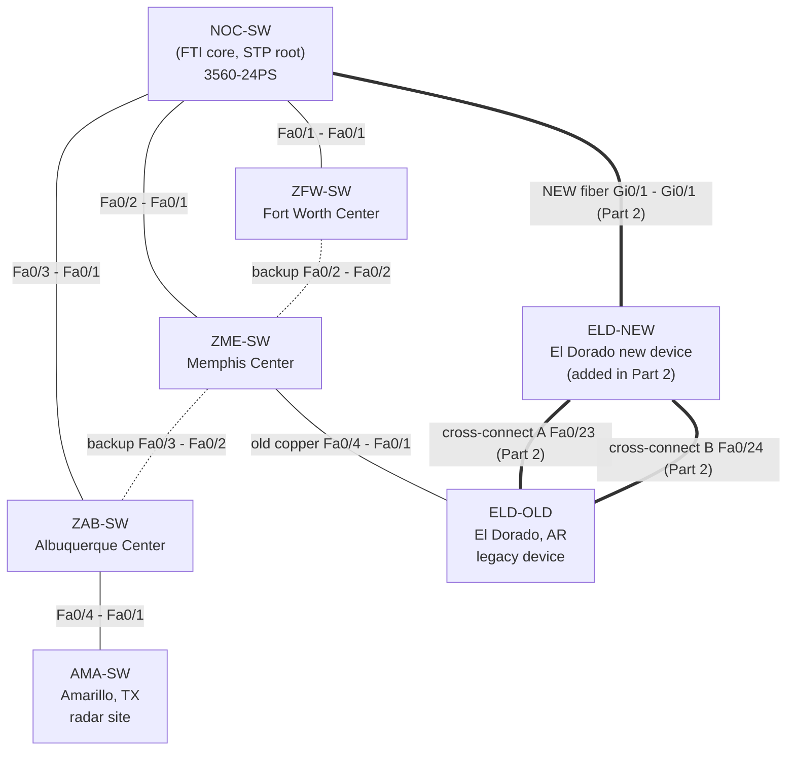

# Topology: "FTI-lite"

A deliberately small model of a national air traffic network: one core, three en route Centers, and two remote sites. Center names are real FAA identifiers used for flavor. Which Center serves which site is simplified for the lab.

## Diagram



ASCII version for printing:

```
                          +----------------+
                          |     NOC-SW     |  STP root (priority 4096)
                          |  [NOC-MON PC]  |
                          +-+-----+------+-+
                      Fa0/1 |     |Fa0/2 | Fa0/3          Gi0/1
            +---------------+     |      +---------+      ======== NEW fiber (Part 2)
            |                     |                |             ||
      +-----+------+        +-----+------+   +-----+------+      ||
      |   ZFW-SW   |........|   ZME-SW   |...|   ZAB-SW   |      ||
      | Fort Worth | backup |  Memphis   |bkp| Albuquerque|      ||
      +------------+        +-----+------+   +-----+------+      ||
                                  | Fa0/4          | Fa0/4       ||
                       old copper |                |             ||
                            +-----+------+   +-----+------+ +----++------+
                            |  ELD-OLD   |   |   AMA-SW   | |  ELD-NEW   |
                            | El Dorado  |   |  Amarillo  | | El Dorado  |
                            |  [RADIO]   |   |  [RADAR]   | |   (new)    |
                            +--+------+--+   +------------+ +--+------+--+
                               |Fa0/23|                        |Fa0/23|
                               |Fa0/24|========================|Fa0/24|
                               +------+   cross-connects A+B   +------+
                                                (Part 2)

     ........ = backup trunk (spanning tree should block one end)
     ======== = added during the Part 2 cutover
```

## Devices

| Device | Packet Tracer model | Role | Added in |
|---|---|---|---|
| NOC-SW | 3560-24PS | FTI core and NOC. Spanning-tree root. | Part 1 |
| ZFW-SW | 2960-24TT | Fort Worth Center | Part 1 |
| ZME-SW | 2960-24TT | Memphis Center | Part 1 |
| ZAB-SW | 2960-24TT | Albuquerque Center | Part 1 |
| ELD-OLD | 2960-24TT | El Dorado radio site, legacy device on copper | Part 1 |
| AMA-SW | 2960-24TT | Amarillo radar site (upgraded 3 weeks ago) | Part 1 |
| ELD-NEW | 2960-24TT | El Dorado new fiber edge device | Part 2 |
| ELD-RTR | 2911 | El Dorado routed edge | Part 4 |

> **Why are the "routers" modeled as switches?** In the real event, the new device was a router. Packet Tracer routers don't bridge traffic between ports, so they can't take part in a broadcast storm. That fact is the whole point of Part 4. To show the storm, the El Dorado edge devices are modeled as Layer 2 switches that extend the shared FTI network to the site.

## Cabling

Use **Copper Cross-Over** between two switches and **Copper Straight-Through** between a switch and a PC, server, or router. Packet Tracer's automatic connection (lightning bolt) also works if you then pick the right ports.

| # | From | Port | To | Port | Notes |
|---|---|---|---|---|---|
| 1 | NOC-SW | Fa0/1 | ZFW-SW | Fa0/1 | Trunk |
| 2 | NOC-SW | Fa0/2 | ZME-SW | Fa0/1 | Trunk |
| 3 | NOC-SW | Fa0/3 | ZAB-SW | Fa0/1 | Trunk |
| 4 | ZFW-SW | Fa0/2 | ZME-SW | Fa0/2 | Backup trunk |
| 5 | ZME-SW | Fa0/3 | ZAB-SW | Fa0/2 | Backup trunk |
| 6 | ZME-SW | Fa0/4 | ELD-OLD | Fa0/1 | Legacy "copper" uplink |
| 7 | ZAB-SW | Fa0/4 | AMA-SW | Fa0/1 | Uplink |
| 8 | NOC-SW | Fa0/10 | NOC-MON | Fa0 | |
| 9 | ZFW-SW | Fa0/10 / Fa0/11 | ZFW-RADAR / ZFW-VOICE | Fa0 | |
| 10 | ZME-SW | Fa0/10 / Fa0/11 | ZME-RADAR / ZME-VOICE | Fa0 | |
| 11 | ZAB-SW | Fa0/10 / Fa0/11 | ZAB-RADAR / ZAB-VOICE | Fa0 | |
| 12 | ELD-OLD | Fa0/10 | ELD-RADIO (Server) | Fa0 | |
| 13 | AMA-SW | Fa0/10 | AMA-RADAR (Server) | Fa0 | |
| **Part 2** | | | | | |
| 14 | NOC-SW | Gi0/1 | ELD-NEW | Gi0/1 | The "new fiber." It's a copper cross-over cable in PT, so label it FIBER. |
| 15 | ELD-NEW | Fa0/23 | ELD-OLD | Fa0/23 | Cross-connect A |
| 16 | ELD-NEW | Fa0/24 | ELD-OLD | Fa0/24 | Cross-connect B |
| **Part 4** | | | | | |
| — | *delete* #6 and #14 | | | | |
| 17 | ZME-SW | Fa0/4 | ELD-RTR | Gi0/0 | Straight-through |
| 18 | ELD-RTR | Gi0/1 | ELD-NEW | Gi0/1 | Straight-through |

## VLANs and IP plan

| VLAN | Name | Subnet | Carries |
|---|---|---|---|
| 100 | SURVEILLANCE | 10.100.0.0/24 | Radar data to controller displays |
| 200 | VOICE | 10.200.0.0/24 | Radio/voice links to remote radio sites |

| Host | Type | Connects to | VLAN | IP / Mask | Gateway |
|---|---|---|---|---|---|
| NOC-MON | PC | NOC-SW Fa0/10 | 100 | 10.100.0.5 /24 | (none) |
| ZFW-RADAR | PC | ZFW-SW Fa0/10 | 100 | 10.100.0.11 /24 | (none) |
| ZME-RADAR | PC | ZME-SW Fa0/10 | 100 | 10.100.0.12 /24 | (none) |
| ZAB-RADAR | PC | ZAB-SW Fa0/10 | 100 | 10.100.0.13 /24 | (none) |
| AMA-RADAR | Server | AMA-SW Fa0/10 | 100 | 10.100.0.60 /24 | (none) |
| ZFW-VOICE | PC | ZFW-SW Fa0/11 | 200 | 10.200.0.11 /24 | 10.200.0.20 |
| ZME-VOICE | PC | ZME-SW Fa0/11 | 200 | 10.200.0.12 /24 | 10.200.0.20 |
| ZAB-VOICE | PC | ZAB-SW Fa0/11 | 200 | 10.200.0.13 /24 | 10.200.0.20 |
| ELD-RADIO | Server | ELD-OLD Fa0/10 | 200 | 10.200.0.50 /24 → **172.16.20.10 /24 in Part 4** | (none) → **172.16.20.1 in Part 4** |
| ELD-RTR Gi0/0 | Router | ZME-SW Fa0/4 | 200 | 10.200.0.20 /24 | — (Part 4) |
| ELD-RTR Gi0/1 | Router | ELD-NEW Gi0/1 | site | 172.16.20.1 /24 | — (Part 4) |

The VOICE PCs get gateway 10.200.0.20 from the start. It isn't used until Part 4 adds ELD-RTR, so there's nothing to change later.
