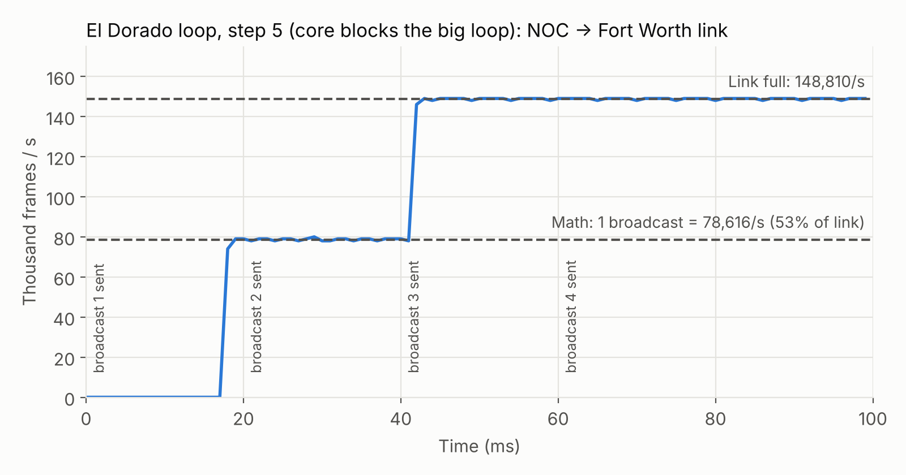
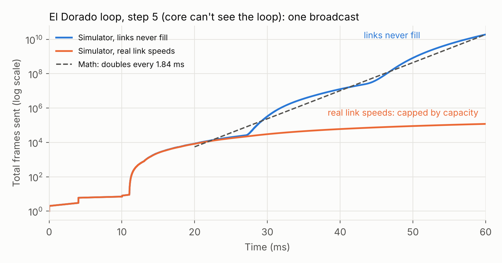

# Storm Math: predicting broadcast storms without simulating packets

A prototype for the "detail levels" simulator design. **Question:** can a single number calculated from the network layout predict what a broadcast storm will do, accurately enough to replace packet-by-packet simulation for devices nobody is looking at?

**Answer, for the FAA ground stop lab network: yes.** The math agreed with an independent packet simulator in every scenario tested.

```bash
pip install numpy matplotlib pytest
python3 -m pytest -q        # 16 tests: pure math + math-vs-simulator
python3 run_report.py       # every lab scenario -> results/
```

## The idea in one paragraph

When a switch floods a broadcast, it sends a copy out every port except the one the frame came in on. Count frames by which link direction they're on. One hop later, each frame turns into one frame on every *other* link leaving the next switch. That rule is a matrix, the **non-backtracking matrix** `B` of the network. Its largest eigenvalue, the **spectral radius ρ**, tells you what any broadcast will do:

| ρ | Verdict | What happens to one broadcast |
|---|---|---|
| 0 | **TREE** | Dies out after a few hops. The network is healthy. |
| 1 | **CIRCULATING** | Loops forever without multiplying. Every *new* broadcast adds more looping frames, so load **accumulates**. |
| > 1 | **AMPLIFYING** | Multiplies every hop. This is a true storm, growing exponentially. |

With real link delays, the math also gives the **growth rate in real time**. It's the `r` that solves ρ(diag(e^(−r·d)) B) = 1, a renewal equation. The matching eigenvector predicts **which links carry the most storm traffic**. For circulating loops, it predicts the **exact frames per second** each link and host will see.

## Results on the FAA lab network

Every row compares the math against `stormmath/sim.py`, a separate packet simulator. The simulator models serialization, propagation, switch lookup time, and FIFO queues, and it knows nothing about matrices.

| Lab step | ρ | Verdict | Math vs simulator |
|---|---|---|---|
| Part 1 baseline | 0 | TREE | 11 copies per broadcast, both |
| Step 2: fiber added | 0 | TREE | 12 copies, both |
| Step 4, core sees the loop | 0 | TREE | 12 copies, both |
| Step 4, core blind | 1 | CIRCULATING | 125 vs 127 broadcasts/s at NOC (slow loop, sampling noise) |
| **Step 5, core sees the big loop** | **1** | **CIRCULATING** | **78,616 vs 78,613 broadcasts/s hitting every Center** |
| **Step 5, core blind** | **1.544** | **AMPLIFYING** | **doubles every 1.84 ms, both** |
| Part 3 hardened | 0 | TREE | 12 copies, both |
| Part 4 routed, mistake re-made | 1 | CIRCULATING | storm reaches **only El Dorado**; 78,616 vs 78,620/s |
| What-if: core STP off | 1.521 | AMPLIFYING | doubles every 10.44 ms, both |

Full table: [`results/results-table.md`](results/results-table.md). The hotspot predictions (share of storm traffic on each link) matched the simulator to within 0.1 percentage points.



**Figure 1.** A ρ = 1 loop isn't harmless. One broadcast loops forever and puts **53% load** on each national link out of the core. The math predicted 78,616 frames/s. The **second** broadcast fills the links completely. Normal network chatter (ARP) produces broadcasts like these every second.



**Figure 2.** A ρ > 1 loop. The math's growth rate matches once the storm settles, after about 20 ms. With real link speeds (orange), links fill within milliseconds.

## Things we learned (including surprises)

1. **The Packet Tracer lab's answer key was partly wrong, and the math caught it.** Two cables between two switches with spanning tree off does *not* make frames multiply. It's a ρ = 1 loop. The real damage comes from **accumulation**: each new broadcast adds a permanently looping frame. Frames multiply exponentially only if the core *also* can't see the bigger loop. The lab's teacher guide has been corrected.
2. **"Can't see what you don't model" gets a partial answer.** The math flags dangerous loops from the layout alone, before any traffic flows, and names every device the storm would reach. That's exactly what a detail-level scheduler needs to decide which devices to promote to full simulation.
3. **The routed redesign is provably contained.** The set of devices the storm can reach shrinks from the whole country to El Dorado alone, computed and not just observed.
4. **Long-run growth predictions need time to settle when loops run at very different speeds.** Here, a 25 µs local loop sits inside a 16 ms national loop. The first ~20 ms don't follow the long-run rate (Figure 2). A full detail-level system would need the short-term solution too, or a quick look-ahead simulation for that window.
5. **A bug was caught by the comparison testing itself.** The first version weighted delays on the wrong side of the matrix. Growth rates still matched, because the spectral radius is unaffected, but the hotspot shares were off by 15 points until the simulator exposed it. This is the argument for building differential testing in from day one.

## What this does *not* show

- **Real switches.** Both the math and the simulator are models. The next step is to compare against real Linux bridge or Open vSwitch software and, eventually, vendor images.
- **Spanning tree behavior.** Which ports block is an input here, not computed. A real STP model, including how STP-disabled switches pass BPDUs, would feed the math automatically.
- **Network numbers.** Link delays and speeds are illustrative, not FAA data. Only one VLAN is modeled.
- **The real FAA cause.** It's still under investigation and may not have been a Layer 2 broadcast storm at all.
- **Novelty.** The math is established graph theory. Using it to drive a mixed-detail network simulator is, as far as we know, uncommon, but no literature search has been done.

## Layout

```
stormmath/topology.py   devices, links, port states
stormmath/analysis.py   the math: B, ρ, growth rate, hotspots, steady rates, storm reach
stormmath/sim.py        independent packet simulator (+ bundled mode for long runs)
stormmath/scenarios.py  the Packet Tracer lab network in every lab state
tests/                  math-only tests + math-vs-simulator tests
run_report.py           regenerates results/
```
